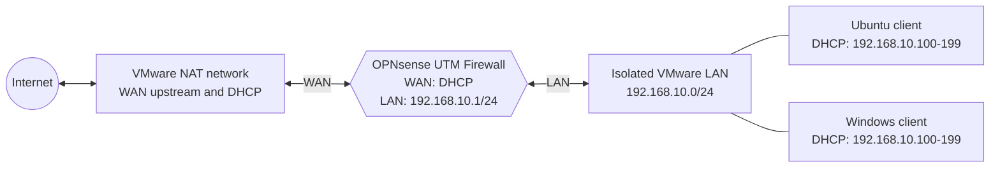

# Week 2: Network Design and Firewall Policy Test Plan

## 1. Purpose and scope

This document defines the network architecture, IPv4 addressing, expected traffic flows, and firewall policy tests for the OPNsense UTM laboratory. It is a design specification for later implementation. The expected results in this document have not yet been validated on a live system; actual results, logs, and screenshots will be collected during the configuration and testing phases.

The Week 2 topology contains one OPNsense firewall and two LAN clients. A DMZ is outside the current scope.

## 2. Network topology

The OPNsense VM is the only system connected to both networks. Neither LAN client has a direct adapter on the VMware NAT network. Consequently, client traffic must pass through OPNsense before reaching the Internet.

### 2.1 Virtual machine requirements

| Virtual machine | Function | vCPU | RAM | Network adapters |
|---|---|---:|---:|---|
| OPNsense | Firewall, router, NAT gateway, DHCP and DNS service | 2 | 3–4 GB | WAN: VMware NAT; LAN: isolated LAN |
| Ubuntu | Linux test client | 2 | 2 GB | Isolated LAN only |
| Windows | Windows test client | 2 | 4 GB | Isolated LAN only |

## 3. IPv4 addressing plan

| Component | Interface or service | Addressing | Purpose |
|---|---|---|---|
| VMware NAT | Upstream virtual network | Host-dependent private subnet | Provides upstream connectivity and DHCP to the OPNsense WAN interface |
| OPNsense | WAN | IPv4 by DHCP | Receives an address, gateway, and upstream connectivity from VMware NAT |
| OPNsense | LAN | `192.168.10.1/24` | Default gateway, DNS endpoint, and management address for LAN clients |
| OPNsense DHCP | LAN pool | `192.168.10.100–192.168.10.199` | Dynamically assigns client addresses |
| Ubuntu client | LAN | DHCP reservation or dynamic lease from the LAN pool | Linux test endpoint |
| Windows client | LAN | DHCP reservation or dynamic lease from the LAN pool | Windows test endpoint |

Client DHCP options shall advertise:

- Network prefix: `/24` (`255.255.255.0`)
- Default gateway: `192.168.10.1`
- DNS server: `192.168.10.1`

The WAN subnet is intentionally not fixed because VMware selects it on the host. Before implementation, the assigned WAN network must be checked to confirm that it does not overlap `192.168.10.0/24`. If it overlaps, the LAN must be changed to another RFC 1918 `/24` before any rules or DHCP settings are applied.

## 4. Expected traffic flows

### 4.1 LAN client to the Internet

An Ubuntu or Windows client sends traffic to its default gateway, `192.168.10.1`. OPNsense evaluates the packet against the LAN rules, creates a state entry for permitted traffic, and translates the private source address through outbound NAT on the WAN interface. VMware NAT then forwards the traffic toward the Internet.

### 4.2 Return traffic for an established connection

Response traffic arrives on the OPNsense WAN interface. The state table associates it with the connection initiated from the LAN, reverses the NAT translation, and forwards it to the originating client. A separate broad WAN allow rule is not required for established return traffic.

### 4.3 Unsolicited WAN-to-LAN traffic

Traffic arriving from WAN without a matching state or an explicit inbound rule is denied by the default WAN policy. No port-forwarding rule is included in the Week 2 design, so internal clients are not directly exposed through OPNsense.

### 4.4 DNS resolution

LAN clients send DNS queries to `192.168.10.1` on UDP or TCP port 53. OPNsense resolves or forwards the queries according to its DNS service configuration. This centralizes client DNS behavior and simplifies later logging or filtering.

### 4.5 Firewall management

Administrators access the OPNsense web interface at `https://192.168.10.1` from the isolated LAN. Administrative access from WAN is not permitted. This restriction reduces exposure of the management plane.

## 5. Firewall design principles

- **Stateful inspection:** permitted sessions create state entries, and only matching response traffic is returned automatically.
- **Default-deny inbound policy:** unsolicited connections arriving on WAN are blocked unless a later requirement introduces an explicit, narrowly scoped rule.
- **Controlled LAN egress:** required services are allowed from LAN; specific prohibited services are blocked by higher-priority rules.
- **Automatic outbound NAT:** private LAN addresses are translated to the OPNsense WAN address for external access.
- **LAN-only management:** the OPNsense HTTPS management interface is reachable from the trusted LAN but not from WAN.
- **Security logging:** explicit deny rules used for testing and default WAN blocks are logged to support later verification.
- **Least privilege and rule order:** specific block or management rules are evaluated before general allow rules.

## 6. Proposed rule order

Rules are evaluated on the interface where traffic enters OPNsense. The following order prevents the general LAN allow rule from overriding the test restrictions.

| Order | Interface | Action | Source | Destination | Protocol/port | Logging | Purpose |
|---:|---|---|---|---|---|---|---|
| 1 | LAN | Pass | `LAN net` | `LAN address` | TCP 443 | Optional | Permit HTTPS management from LAN |
| 2 | LAN | Pass | `LAN net` | `LAN address` | ICMP echo request | Optional | Permit gateway diagnostics |
| 3 | LAN | Block | `LAN net` | Any | TCP 23 | Enabled | Prohibit outbound Telnet for a safe negative test |
| 4 | LAN | Pass | `LAN net` | `LAN address` | TCP/UDP 53 | Optional | Permit DNS through OPNsense |
| 5 | LAN | Pass | `LAN net` | Any | TCP 80 and 443 | Optional | Permit normal web access |
| 6 | WAN | Block/default deny | Any | `LAN net` | Any | Enabled | Reject unsolicited inbound traffic |

OPNsense state handling permits response traffic for sessions allowed by the LAN rules. Automatic outbound NAT translates the permitted LAN traffic. The implementation phase must verify whether the DNS service is bound to the LAN interface and whether its automatically generated rules already provide the required access before adding redundant rules.

## 7. Firewall policy test matrix

The table records **expected design outcomes only**. The “Actual result” and “Evidence” fields are intentionally deferred until the corresponding rules are implemented and tested.

| ID | Source | Destination | Protocol/port | Expected action | Applicable interface or rule | Planned verification | Expected log behavior |
|---|---|---|---|---|---|---|---|
| FW-01 | Ubuntu LAN client | External HTTP test site | TCP 80 | Allow | LAN web allow; automatic outbound NAT | Run `curl -I http://example.com` and confirm an HTTP response | Pass log optional; state and NAT session should be observable |
| FW-02 | Windows LAN client | External HTTPS test site | TCP 443 | Allow | LAN web allow; automatic outbound NAT | Open `https://example.com` or run `Test-NetConnection example.com -Port 443` | Pass log optional; state and NAT session should be observable |
| FW-03 | Ubuntu and Windows clients | OPNsense LAN address | UDP/TCP 53 | Allow | LAN DNS allow and local DNS service | Run `nslookup example.com 192.168.10.1` on both clients | DNS service log may record queries; no block entry is expected |
| FW-04 | External servers replying to a LAN-originated session | Originating LAN client | Stateful return traffic | Allow only when a matching state exists | OPNsense state table | Start an HTTP/HTTPS request from LAN and inspect its established state | State entry should show bidirectional packets; no WAN block is expected |
| FW-05 | WAN-side test host | LAN client or `192.168.10.0/24` | Unsolicited TCP connection | Block | WAN default deny | From a controlled WAN-side host, attempt a TCP connection to a LAN address; do not create a port forward | Firewall log should record a WAN block when the packet reaches OPNsense |
| FW-06 | Ubuntu LAN client | Any external host | TCP 23 | Block while HTTP/HTTPS remains allowed | High-priority LAN Telnet block | Attempt `nc -vz <controlled-test-host> 23`, then repeat FW-01 or FW-02 | Explicit LAN block should be logged; permitted web traffic remains functional |
| FW-07 | Ubuntu or Windows LAN client | `192.168.10.1` | ICMP echo request | Allow | LAN diagnostic rule | Run `ping 192.168.10.1` and confirm replies | Pass log optional; no block entry is expected |
| FW-08 | LAN administrator; separately, WAN-side test host | OPNsense management address | TCP 443 | Allow from LAN; block from WAN | LAN management allow and WAN default deny | Open `https://192.168.10.1` from LAN, then attempt WAN access from a controlled WAN-side host | LAN access may be logged; WAN attempt should produce a block entry |

### 7.1 Test safety and validity

- Tests must target systems owned by the project team or benign public endpoints such as `example.com`.
- The WAN-side tests must use a controlled host on the VMware NAT segment and must not scan unrelated systems.
- FW-05 validates policy behavior only if the test packet actually reaches the OPNsense WAN interface. VMware NAT may itself prevent inbound connections, so packet capture or a controlled same-segment host should be used to distinguish an upstream drop from an OPNsense block.
- TCP port 23 is selected for the outbound block test because it represents insecure Telnet traffic. The controlled destination does not need to provide a Telnet login service; packet capture and firewall logs can confirm the rule match.
- Real IP addresses, timestamps, screenshots, rule identifiers, and observed outcomes must be added only after executing the tests.

## 8. Acceptance criteria for later implementation

The design will be considered successfully implemented when:

1. Both clients receive an address within `192.168.10.100–192.168.10.199` with gateway and DNS set to `192.168.10.1`.
2. The WAN address is assigned by VMware DHCP and does not overlap the LAN subnet.
3. HTTP, HTTPS, and DNS tests succeed from the LAN.
4. Established return traffic is accepted without a broad WAN allow rule.
5. Unsolicited WAN traffic and outbound TCP port 23 are blocked and logged.
6. ICMP diagnostics and HTTPS management work from LAN.
7. The management interface remains inaccessible from WAN.
8. Test logs and screenshots correspond to the actual commands and results produced during the later test phase.

## 9. Week 2 deliverable status

The topology, addressing plan, traffic-flow model, security principles, proposed rule order, and eight firewall policy tests are complete as design artifacts. Installation, live rule configuration, execution evidence, and measured results remain scheduled for subsequent project weeks.
